 

**ESTRATEGIA EMPRESARIAL &nbsp; ✦ &nbsp; TECNOLOGÍA &nbsp; ✦ &nbsp; INNOVACIÓN**

[Sobre mí](#sobre-mí) &nbsp; · &nbsp; [Mi enfoque](#mi-enfoque) &nbsp; · &nbsp; [Proyectos](#proyectos) &nbsp; · &nbsp; [Tecnologías](#tecnologías)

 

## Sobre mí

Hola, soy **Lenin Silva**, **ingeniero empresarial**.

Me interesa conectar la visión de negocio con la tecnología: entender una necesidad, convertirla en una idea clara y construir una solución que aporte valor. Este es mi espacio para compartir lo que desarrollo, explorar nuevas herramientas y seguir mejorando.

> **Mi misión:** transformar ideas en proyectos con propósito.

## Mi enfoque

| 🧭 Estrategia | 🛠️ Construcción | 🌌 Evolución |
| :--- | :--- | :--- |
| Entender el problema y el valor que puede generar una solución. | Llevar las ideas a experiencias y herramientas digitales. | Aprender, probar y mejorar con cada proyecto. |

## Proyectos

Una primera exploración de mis repositorios públicos:

### 🪐 [ZigZag · Experiencia web gastronómica](https://github.com/lenosito159-bit/alpine-andes-echo)

Sitio web de temática gastronómica para ZigZag Restaurant, con páginas de menú, historia, galería, reservas y contacto.

**En el repositorio:** React · TypeScript · TanStack Start · Tailwind CSS

[Explorar repositorio ↗](https://github.com/lenosito159-bit/alpine-andes-echo)

### 🛰️ [Visible-Digital · Pruebas de APIs](https://github.com/lenosito159-bit/Visible-Digital)

Proyecto para automatizar pruebas de APIs, validar respuestas y consultar un catálogo de APIs públicas. Incluye un cliente HTTP y un flujo de integración continua con GitHub Actions.

**En el repositorio:** JavaScript · Node.js · Vitest · Zod · GitHub Actions

[Explorar repositorio ↗](https://github.com/lenosito159-bit/Visible-Digital)

## Tecnologías

Herramientas presentes en mis proyectos públicos:

**Interfaces** &nbsp; React · TypeScript · Tailwind CSS · TanStack

**APIs y validación** &nbsp; JavaScript · Node.js · Vitest · Zod

**Colaboración y automatización** &nbsp; GitHub · GitHub Actions

 

**Cada proyecto es una nueva órbita.**

[Explora mis repositorios públicos →](https://github.com/lenosito159-bit?tab=repositories)

