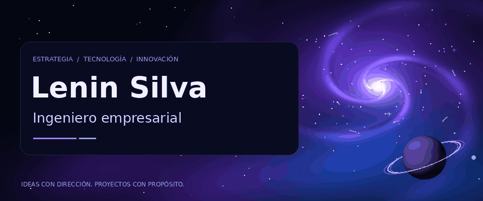
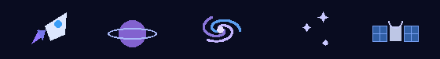

  

<h1 align="center">Lenin Silva · Ingeniero empresarial</h1>

<strong>Estrategia · Tecnología · Innovación</strong>

  <picture>
    <source media="(prefers-reduced-motion: reduce)" srcset="assets/intro-still.png">
    
  </picture>

<a href="assets/PERFIL-ESTATICO.md">Ver perfil sin animaciones</a> · <a href="#proyectos">Proyectos</a> · <a href="#tecnologias">Tecnologías</a>

---

## 🌌 Mi universo

Hola, soy **Lenin Silva**, **ingeniero empresarial**.

Me interesa conectar la visión de negocio con la tecnología: entender una necesidad, convertirla en una idea clara y construir una solución que aporte valor. Este es mi espacio para compartir lo que desarrollo, explorar nuevas herramientas y seguir mejorando.

> **Mi misión:** transformar ideas en proyectos con propósito.

### Mi enfoque

- **🧭 Estrategia:** entender el problema y el valor que puede generar una solución.
- **🛠️ Construcción:** llevar las ideas a experiencias y herramientas digitales.
- **🌌 Evolución:** aprender, probar y mejorar con cada proyecto.

  <picture>
    <source media="(prefers-reduced-motion: reduce)" srcset="assets/orbit-signals-still.png">
    
  </picture>

🚀 Explorar &nbsp; · &nbsp; 🪐 Conectar &nbsp; · &nbsp; 🌌 Imaginar &nbsp; · &nbsp; ✨ Crear &nbsp; · &nbsp; 🛰️ Construir

## 🚀 Proyectos

Una primera exploración de mis repositorios públicos:

### 🪐 [ZigZag · Experiencia web gastronómica](https://github.com/lenosito159-bit/alpine-andes-echo)

Sitio web de temática gastronómica para ZigZag Restaurant, con páginas de menú, historia, galería, reservas y contacto.

**En el repositorio:** React · TypeScript · TanStack Start · Tailwind CSS

[Explorar repositorio ↗](https://github.com/lenosito159-bit/alpine-andes-echo)

### 🛰️ [Visible-Digital · Pruebas de APIs](https://github.com/lenosito159-bit/Visible-Digital)

Proyecto para automatizar pruebas de APIs, validar respuestas y consultar un catálogo de APIs públicas. Incluye un cliente HTTP y un flujo de integración continua con GitHub Actions.

**En el repositorio:** JavaScript · Node.js · Vitest · Zod · GitHub Actions

[Explorar repositorio ↗](https://github.com/lenosito159-bit/Visible-Digital)

[Todos mis repositorios →](https://github.com/lenosito159-bit?tab=repositories)

## 🛰️ Tecnologías

Herramientas presentes en mis proyectos públicos:

**Interfaces** &nbsp; React · TypeScript · Tailwind CSS · TanStack

**APIs y validación** &nbsp; JavaScript · Node.js · Vitest · Zod

**Colaboración y automatización** &nbsp; GitHub · GitHub Actions

---

<strong>✨ Estrategia para orientar. Tecnología para construir. Innovación para avanzar.</strong>

### Conectemos

[GitHub · @lenosito159-bit](https://github.com/lenosito159-bit)
